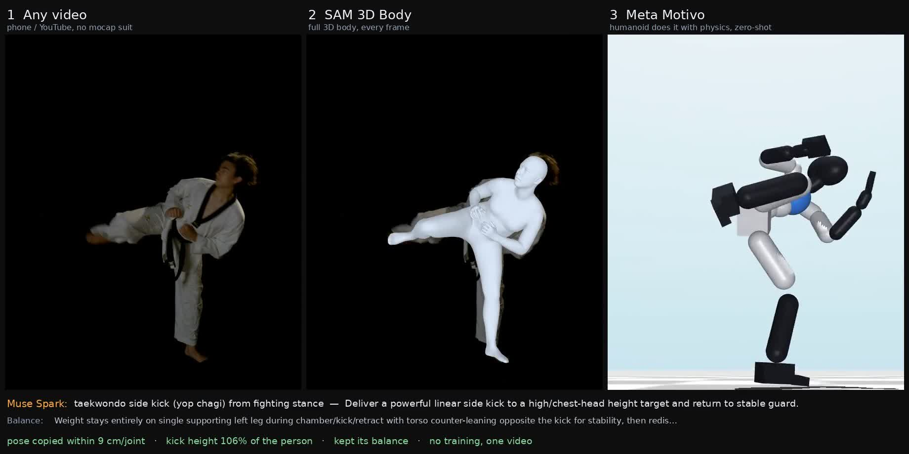
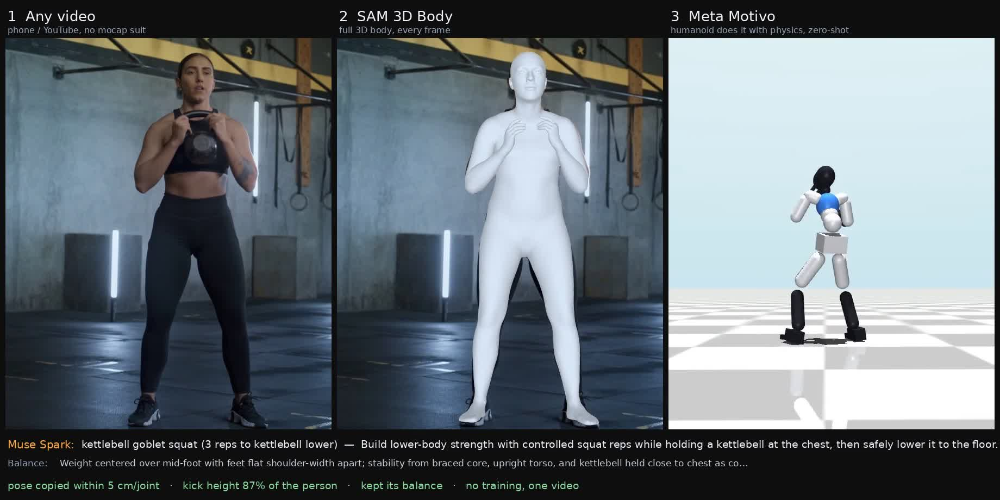
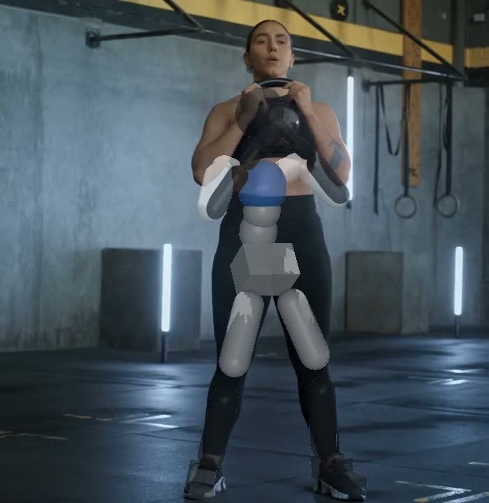
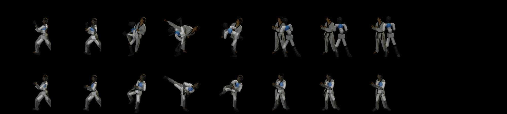

# Holo: teach a humanoid from one video

Show a physics-simulated humanoid **one ordinary video** of a person, and it performs the move. There's **no motion-capture suit and no training per skill**, and Muse Spark explains what the move is and why.



**Pipeline:** any video → **SAM 3D Body** → retarget → **Meta Motivo** humanoid (physics, zero-shot), plus **Muse Spark Open** for intent.

Demo video (with voiceover): [`docs/demo.mp4`](docs/demo.mp4)

---

## How it works

| Step | Model | What it does |
|---|---|---|
| 1. See the body | **SAM 3D Body** (Meta, `facebook/sam-3d-body-dinov3`) | Full 3D human body for every frame of a normal video: 70 MHR keypoints in metres, plus the camera |
| 2. Retarget | MuJoCo IK (ours) | Keeps the person's **bone directions** and uses the **humanoid's bone lengths**, then fits the HumEnv/SMPL humanoid with inverse kinematics (about 2 cm per joint) |
| 3. Do it with physics | **Meta Motivo** (`facebook/metamotivo-M-1`) | The motion becomes a *tracking prompt*. The behavioral foundation model controls the humanoid **zero-shot**, with gravity, contacts and balance |
| 4. Understand it | **Muse Spark Open** (`meta-models/muse-spark-open-1026`, Baseten) | Names the move and gives its goal, phases, balance, what's hard for a robot, and useful edits |
| 5. Check it | ours | Renders the robot **from the original camera** (focal length recovered from SAM 3D Body's 2D/3D joints) and ghosts it over the person, plus a numeric report card |

## Results (pure Motivo, no assist forces, no training)

| Clip | Posture error (per joint) | Kick/height reached | Fell? | Heading error |
|---|---|---|---|---|
| Taekwondo side kick | **9.1 cm** | **106%** of the person | no | 75° (see limits) |
| Squats (kettlebell goblet squat, 3 reps) | **5.3 cm** | n/a | no | 16° |



**Same-camera check:** the robot is rendered from the exact original camera and drawn over the person.





*Top: the robot drawn over the person from the exact original camera. Bottom: the fitted target motion over the person, which matches throughout.*

### What Muse Spark said (kick)
> **taekwondo side kick (yop chagi) from fighting stance**: Deliver a powerful linear side kick to a high/chest-head height target and return to stable guard.
> Balance: Weight stays entirely on single supporting left leg during chamber/kick/retract with torso counter-leaning opposite the kick for stability, then redistributed evenly to both feet on recovery.

## Honest limits
- **Heading drift on fast turning moves.** Motivo's input is body-relative, so it doesn't know which way it faces in the room. On the fast side kick it ends up turned and drifts. The posture is copied well, but the global heading isn't. A training-free command-steering attempt didn't fix it, and we report it rather than hide it. In-place moves (squats) are much better. A small heading-aware adapter on top of Motivo is the next step.
- Motivo is weaker on very fast moves and moves on the ground (stated by Meta).
- This is simulation. The motion can be retargeted to a real humanoid (e.g. a Unitree G1) as future work.

## Report files
`docs/report_*.json` and `docs/intent_*.json` hold the raw numbers and Muse's full read of each clip.

## Run it
GPU box (RTX 4090 is fine):
```bash
# SAM 3D Body env (see facebookresearch/sam-3d-body INSTALL.md), then:
python pipeline/extract_body.py clip.mp4 body.npz --fps 30 --render mesh/
# Motivo env: pip install "metamotivo[huggingface] @ git+https://github.com/facebookresearch/metamotivo" "humenv[bench] @ git+https://github.com/facebookresearch/humenv" mujoco imageio scipy opencv-python-headless
MUJOCO_GL=egl python pipeline/retarget_track.py body.npz out/ --model facebook/metamotivo-M-1 --video clip.mp4
```
Laptop:
```bash
python pipeline/muse_intent.py clip.mp4 intent.json          # needs meta_baseten=<key> in ../.env
python pipeline/compose.py clip.mp4 mesh/ out/robot.mp4 intent.json out/report.json result.mp4
```
`retarget_track.py` writes `target.mp4`, `robot.mp4`, `overlay.mp4` (same camera), `overlay_target.mp4` and `report.json`.

## Credits
Meta: SAM 3D Body, MHR, Meta Motivo, HumEnv, Muse Spark Open. Physics: MuJoCo. Clips: Mixkit free stock video (Mixkit licence).

Earlier work in this repo (Holo live AI guide: Muse Spark + SAM 3.1 + DINOv3) is in the git history.
